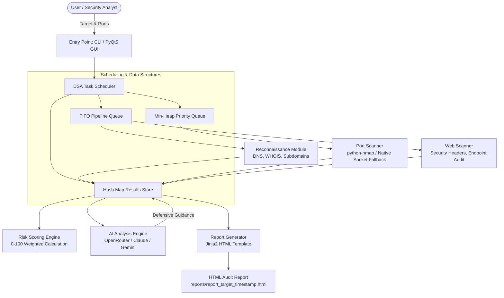

# CyberSentinel 🛡️

**Automated Cybersecurity Assessment & Reconnaissance Toolkit with AI-Powered Defensive Analysis**

[](https://www.python.org/)
[](LICENSE)
[](#architecture)
[](#security-boundaries--authorized-use-policy)
[](#testing-and-quality-assurance)

---

## 1. Overview & Project Objectives

**CyberSentinel** is an automated, non-invasive security assessment toolkit engineered for authorized infrastructure reconnaissance, port and service auditing, HTTP security posture verification, and AI-assisted defensive vulnerability analysis.

Traditional security assessment tools either produce raw, unprioritized scanner output that overwhelms junior administrators or require complex multi-tool configurations. CyberSentinel addresses this problem by:
- **Streamlining Assessment Pipelines**: Unifying target normalization, passive DNS/subdomain discovery, port auditing, and HTTP header inspections into a cohesive execution workflow.
- **DSA-Driven Scheduling**: Employing a priority-ordered task queue (min-heap) and FIFO pipeline queues to ensure high-risk attack surfaces (e.g., exposed database or remote administration ports) are probed and scored first.
- **Transparent AI Mitigation**: Translating complex telemetry and findings into actionable, defensive remediation guidance using multi-provider Large Language Models (OpenRouter, Anthropic Claude, and Google Gemini) with automatic fallback and prompt-level non-exploitation guardrails.
- **Interactive & Headless Interfaces**: Providing both a modern PyQt5 cybersecurity-themed GUI (with beginner-friendly Guided Mode) and a headless CLI suitable for automation and lab environments.

> [!IMPORTANT]
> **Defensive Scope & Non-Exploitation Policy**: CyberSentinel is strictly an informational, non-destructive audit tool. It identifies exposed services and configuration weaknesses without launching exploit payloads, modifying remote systems, or bypassing authorization controls.

---

## 2. Key Features

- **🌐 Passive Reconnaissance & Asset Discovery**:
  - Target URL/IP normalization and automatic loopback/IPv4/IPv6 classification.
  - DNS record queries (`A`, `AAAA`, `CNAME`, `MX`, `NS`) using `dnspython`.
  - Passive subdomain resolution using local wordlists.
  - Domain WHOIS retrieval with Python library and system CLI fallback.
- **🔍 Resilient Port Scanning Engine**:
  - Automatic detection of `python-nmap` and system `nmap` binaries.
  - Zero-dependency native TCP socket connect scanner (`_run_socket_port_scan`) fallback when Nmap is not installed.
  - Support for port lists (`80,443`), port ranges (`8000-8010`), and pre-configured port profiles (`web_only`, `database`, `all_common`).
- **🛡️ Non-Invasive Web Security Audit**:
  - Verification of critical defensive HTTP response headers (`Content-Security-Policy`, `Strict-Transport-Security`, `X-Frame-Options`, `X-Content-Type-Options`, `Referrer-Policy`, `Permissions-Policy`).
  - Infrastructure disclosure detection (inspecting `Server` and `X-Powered-By` headers).
  - Common endpoint status probing (detecting status codes `200`, `301`, `302`, `401`, `403` on standard paths like `/robots.txt`, `/login`, `/.git`, `/.env`).
- **🧠 DSA Priority Task Scheduler & Risk Engine**:
  - **FIFO Pipeline Queue**: Sequences assessment stages (`recon` → `port_scan` → `web_assessment`).
  - **Min-Heap Priority Queue**: Prioritizes port scans by known threat severity (e.g., Telnet/SMB/RDP evaluated before ephemeral ports).
  - **Weighted Risk Scoring**: Quantifies risk on a 0–100 scale and maps findings to `Low`, `Medium`, `High`, or `Critical` severity tiers.
- **🤖 Multi-Provider AI Defensive Analysis**:
  - Unified analysis engine supporting **OpenRouter** (free gateway), **Anthropic Claude**, and **Google Gemini**.
  - Dynamic fallback hierarchy: automatically shifts to secondary configured providers if the primary provider hits quota limits or connection errors.
  - Clear distinction between confirmed observations and inferred risk hypotheses.
- **📊 Professional HTML Assessment Reports**:
  - Self-contained HTML reports styled with dark cybersecurity theme via Jinja2 templates.
  - Full findings summary, risk distribution breakdown, open port tables, and structured AI remediation guidance.
- **💻 Dual Interface (CLI & PyQt5 GUI)**:
  - Headless CLI for fast terminal scans and scripted environments.
  - Graphical PyQt5 interface with dark theme, real-time log stream, progress tracking, and API settings management.

---

## 3. Architecture & Data Flow



### Component Breakdown
| Package / Module | Responsibility |
|---|---|
| [`cybersentinel.main`](src/cybersentinel/main.py) | CLI argument parsing, logging setup, and GUI bootstrap dispatch. |
| [`cybersentinel.core.scheduler`](src/cybersentinel/core/scheduler.py) | FIFO pipeline management, min-heap port prioritization, and weighted risk calculation. |
| [`cybersentinel.reconnaissance.recon`](src/cybersentinel/reconnaissance/recon.py) | Passive DNS resolution, subdomain checking, and WHOIS parsing. |
| [`cybersentinel.scanners.port_scanner`](src/cybersentinel/scanners/port_scanner.py) | TCP port auditing via `python-nmap`, subprocess Nmap, or native Python sockets. |
| [`cybersentinel.scanners.web_scanner`](src/cybersentinel/scanners/web_scanner.py) | HTTP response inspection, security header analysis, and endpoint discovery. |
| [`cybersentinel.ai.analyzer`](src/cybersentinel/ai/analyzer.py) | Multi-provider LLM prompt construction, API communication, and response parsing. |
| [`cybersentinel.reporting.report_gen`](src/cybersentinel/reporting/report_gen.py) | Aggregates findings and renders self-contained Jinja2 HTML security audit reports. |
| [`cybersentinel.gui`](src/cybersentinel/gui/) | PyQt5 Guided Mode UI, Settings Manager dialog, and dark theme stylesheet. |

---

## 4. Technology Stack

- **Core Runtime**: Python 3.10+ (tested on Python 3.10, 3.11, 3.12, 3.14)
- **Networking & HTTP**: `requests`, `httpx`, `urllib3`, native `socket`
- **Reconnaissance**: `dnspython`, `python-whois`
- **Port Auditing**: `python-nmap` (optional, falls back gracefully to native socket connects)
- **GUI**: `PyQt5` (optional for CLI; required for GUI mode)
- **Report Rendering**: `Jinja2`
- **AI Integrations**: OpenRouter REST API, Anthropic API (`anthropic`), Google Generative AI (`google-generativeai`)
- **Testing & Packaging**: `pytest`, `setuptools`, `wheel`

---

## 5. How Automated Assessment & AI Analysis Work

### Assessment Pipeline Workflow
1. **Target Normalization**: Strips URLs, protocols, and trailing paths to produce normalized IP or domain names.
2. **Reconnaissance Stage**: Queries authoritative nameservers for DNS records (`A`, `AAAA`, `MX`, `NS`, `CNAME`), tests candidate subdomains against DNS, and extracts registration details via WHOIS.
3. **Port Scanning Stage**: Checks ports in order of risk priority. If Nmap is installed, it uses SYN scan flags (`-sS -Pn -T4`); if absent, it falls back to non-privileged native TCP three-way handshake (`socket.create_connection`).
4. **Web Security Audit Stage**: Issues safe HTTP/HTTPS GET requests to determine active server responses, audits missing defensive headers, detects banner disclosures, and checks standard web paths.
5. **DSA Risk Calculation**: Assigns weighted scores based on:
   - Exposed administrative/database services (`Telnet` = 20, `FTP` = 15, `RDP` = 15)
   - Missing HTTP security headers (10 points each)
   - Exposed paths and directory disclosures (25 points each)
   - Aggregates overall score (0–100) and maps to `Low` (<25), `Medium` (25–49), `High` (50–74), or `Critical` (≥75).

### AI Analysis & Limitations
- **Defensive Framing**: AI models are prompted strictly as defensive cybersecurity analysts. Exploit payloads, cracking instructions, and weaponization details are explicitly prohibited in prompt instructions.
- **Assessment vs. Guarantee**: AI outputs are framed as *advisory assessments and potential risk hypotheses*, not infallible facts.
- **Privacy Notice**: Target telemetry sent to external AI providers includes discovered service names, open ports, and missing headers. No sensitive host files or credentials are transmitted. Users who do not wish to query external cloud APIs can disable AI using `--no-ai`.

---

## 6. Repository Layout

```text
CyberSentinel/
├── .env.example                     # Environment template for AI provider API keys
├── .gitignore                       # Clean gitignore excluding venvs, caches, reports, secrets
├── LICENSE                          # MIT Open Source License
├── pyproject.toml                   # Standard PEP 518/621 packaging metadata & pytest config
├── README.md                        # Documentation and architecture guide
├── requirements.txt                 # Verified Python runtime dependencies
├── src/
│   └── cybersentinel/
│       ├── __init__.py              # Package declaration & version metadata
│       ├── config.py                # Cross-platform paths, tool discovery, port priorities
│       ├── main.py                  # Primary application entry point (CLI & GUI dispatcher)
│       ├── core/
│       │   ├── __init__.py
│       │   └── scheduler.py         # Priority queue, FIFO pipeline, and risk scoring engine
│       ├── reconnaissance/
│       │   ├── __init__.py
│       │   └── recon.py             # DNS resolver, WHOIS query, and subdomain discovery
│       ├── scanners/
│       │   ├── __init__.py
│       │   ├── port_scanner.py      # Nmap backend wrapper & socket scanner fallback
│       │   └── web_scanner.py       # HTTP security headers audit & endpoint discovery
│       ├── ai/
│       │   ├── __init__.py
│       │   └── analyzer.py          # Multi-provider LLM analysis (OpenRouter/Claude/Gemini)
│       ├── reporting/
│       │   ├── __init__.py
│       │   ├── report_gen.py        # Jinja2 report compiler
│       │   └── templates/
│       │       └── report.html      # Self-contained dark cybersecurity HTML template
│       ├── gui/
│       │   ├── __init__.py
│       │   ├── main_window.py       # QMainWindow bootstrap & stylesheet loader
│       │   ├── guided_mode.py       # Beginner-friendly Guided Mode widget & scan thread
│       │   ├── results_panel.py     # Real-time scan results display component
│       │   ├── settings_dialog.py   # Settings manager & API key configuration dialog
│       │   ├── report_dialog.py     # In-app report viewer dialog
│       │   └── style.qss            # Cyber-themed dark QSS stylesheet
│       └── wordlists/
│           └── common.txt           # Non-invasive default wordlist for discovery
├── modules/                         # Backward-compatibility import wrappers
├── main.py                          # Top-level executable wrapper
├── tests/                           # 42 automated tests (pytest suite)
│   ├── conftest.py                  # Test environment & path bootstrap
│   ├── test_recon.py                # Recon & DNS unit tests
│   ├── test_scanner.py              # Port scanner & XML parser tests
│   ├── test_web_assess.py           # Web audit & security header tests
│   ├── test_scheduler.py            # Priority heap & risk scoring tests
│   ├── test_ai_analyzer.py          # LLM prompt, response parser, & fallback tests
│   ├── test_reporting.py            # Jinja2 template rendering tests
│   └── test_config.py               # Config & SettingsManager tests
├── docs/                            # User and developer guides
│   ├── API_KEY_SETUP.md             # Guide to acquiring OpenRouter, Claude, & Gemini keys
│   ├── DEPLOYMENT_GUIDE.md          # Multi-OS installation and deployment walkthrough
│   └── PROJECT_CONTINUITY.md        # Academic background & architecture decision log
└── examples/
    └── sample_report.html           # Sanitized example HTML report artifact
```

---

## 7. Installation & Quick Start

### Prerequisites
- **Python**: Version 3.10 or higher.
- **Operating System**: Windows 10/11, Kali Linux / Ubuntu, or macOS.
- **Optional Tools**: [Nmap](https://nmap.org/download.html) (optional; built-in socket scanner is used automatically if Nmap is absent).

### Step 1: Clone the Repository
```bash
git clone https://github.com/your-username/cybersentinel.git
cd cybersentinel
```

### Step 2: Set Up Virtual Environment
**On Linux / macOS:**
```bash
python3 -m venv venv
source venv/bin/activate
```

**On Windows (PowerShell):**
```powershell
python -m venv venv
.\venv\Scripts\Activate.ps1
```

### Step 3: Install Dependencies
```bash
# Install core dependencies
pip install -r requirements.txt

# Or install as an editable package with development tools
pip install -e ".[dev]"
```

### Step 4: Configure AI API Keys (Optional)
If you want to use AI-assisted analysis, copy `.env.example` to `.env`:
```bash
cp .env.example .env
```
Populate one or more provider keys:
```env
OPENROUTER_API_KEY=your_openrouter_api_key_here
ANTHROPIC_API_KEY=your_claude_api_key_here
GEMINI_API_KEY=your_gemini_api_key_here
```
*(Alternatively, configure keys securely within the PyQt5 GUI via the ⚙️ Settings dialog).*

---

## 8. Usage Instructions

### CLI Mode (Recommended for Terminal & CI/CD)

**1. Safe Localhost Assessment (no external API calls):**
```bash
python main.py 127.0.0.1 --ports 80,443 --no-ai
```

**2. Custom Port Scan on an Authorized Target:**
```bash
python main.py 192.168.1.50 --ports 22,80,443,8080,8443 --no-ai
```

**3. Scan with Specific HTML Output Path:**
```bash
python main.py 127.0.0.1 --ports 80 --output ./audit_summary.html --no-ai
```

**4. Scan with AI Analysis Enabled:**
```bash
python main.py 127.0.0.1 --ports 80,443 -v
```

### GUI Mode (PyQt5 Guided Interface)

Launch the graphical interface:
```bash
python main.py --gui
```
- **Guided Pipeline**: Select pre-configured scan profiles (`FULL PENTEST PIPELINE`, `RECON ONLY`, `PORT SCAN ONLY`, `WEB ASSESSMENT ONLY`).
- **Interactive Log Stream**: Monitor real-time task progress and scan output.
- **Settings Panel**: Configure and test AI provider credentials directly.

---

## 9. Testing and Quality Assurance

The repository includes a comprehensive `pytest` test suite with **42 unit and integration tests** verifying:
- Input sanitization and IP target normalization.
- DNS resolution and passive subdomain enumeration.
- Port parsing, backend auto-selection, and socket connect scanning.
- HTTP security header audit accuracy against OWASP guidelines.
- Priority queue min-heap ordering and risk scoring thresholds.
- AI prompt assembly, response parsing across 3 LLM formats, and provider fallback logic.
- Jinja2 HTML report compilation.

To execute the test suite:
```bash
python -m pytest tests/
```

**Expected Result:**
```text
============================= 42 passed in 2.24s ==============================
```

---

## 10. Security Boundaries & Authorized-Use Policy

CyberSentinel was developed under strict ethical and legal guidelines:
1. **Authorized Testing Only**: Only execute assessments against systems you own, manage, or have explicit, verifiable written authorization to evaluate.
2. **Non-Exploitation Policy**:
   - ❌ **No Exploit Payloads**: The tool does not execute exploits, buffer overflows, injection payloads, or remote code execution routines.
   - ❌ **No Credential Attacks**: No brute-force credential stuffing, password cracking, or dictionary attacks against authenticated services.
   - ❌ **No Denial of Service**: All requests are bounded by request timeouts, discovery limits, and non-destructive inspection.
   - ❌ **No Target Tampering**: Target configurations, data, and access controls are never modified.
3. **Safe Testing Standards**: Use `127.0.0.1` (localhost) or isolated virtualization labs (e.g. VulnHub, TryHackMe, HackTheBox) when demonstrating or evaluating the tool.

---

## 11. Known Limitations & Roadmap

### Current Limitations
- **Stealth & IDS Evasion**: Scans use standard TCP connect / SYN requests and make no attempt to evade network firewalls or IDS/IPS logging.
- **Authentication**: Current web audits inspect unauthenticated public-facing HTTP endpoints only.
- **AI Dependencies**: AI recommendations rely on external model availability unless run in `--no-ai` mode.

### Roadmap
- [ ] Add local LLM inference support (e.g., Ollama / llama.cpp) for air-gapped assessment environments.
- [ ] Export findings in standardized machine-readable formats (`JSON`, `SARIF`, `CSV`).
- [ ] Implement TLS/SSL certificate cipher suite and expiration inspection.
- [ ] Add rate-limiting throttle sliders to the GUI for bandwidth-sensitive environments.

---

## 12. License & Attribution

This project is licensed under the **MIT License** — see the [LICENSE](LICENSE) file for details.

### Academic Attribution
Originally initiated as an academic cybersecurity project at the **University of Petroleum and Energy Studies (UPES)**, Dehradun, under the mentorship of **Debanjan Ghosh**.
- Contributors: Deepanshu Kushwaha (Lead), Yash Yadav, Lakshay Gupta, Utkarsh.
